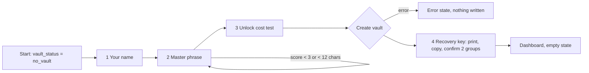
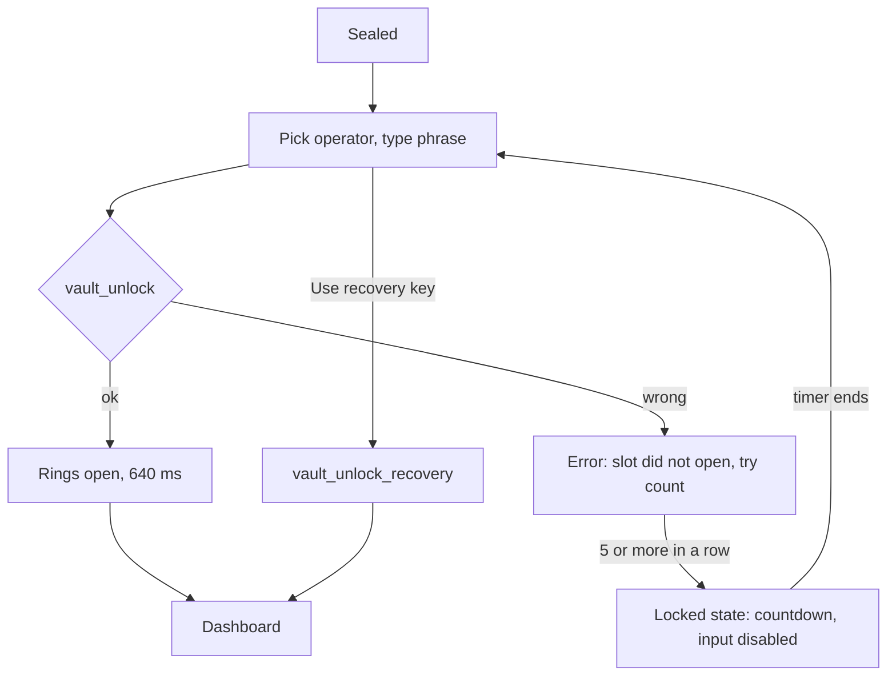
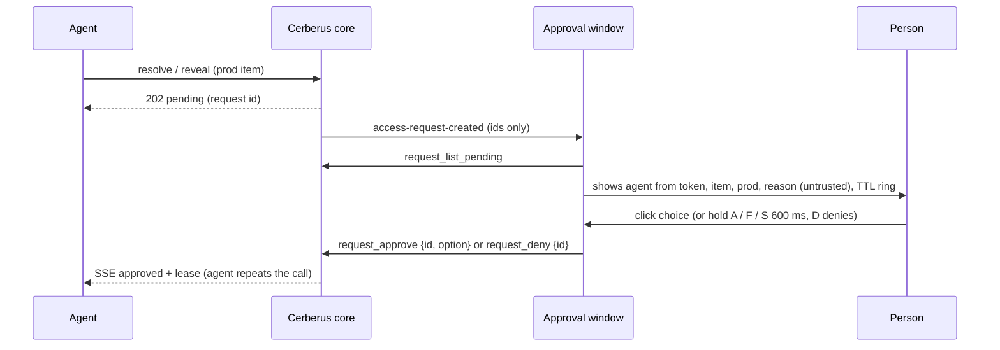

# Cerberus user flows (T14)

Each flow lists the steps, the screen, and the Tauri IPC command (`docs/interfaces.md` section 9) or backend event
that drives it. Prototype links are relative to `docs/ux/prototypes/`.

## F1. First run: create the vault (screen 1, A1)

| Step | UI | IPC |
|---|---|---|
| App start | Route by state | `vault_status` → `no_vault` |
| 1 Name | Owner label; host names (advanced) | — (kept in form state) |
| 2 Phrase | Strength meter on each change (debounced 150 ms); Generate gives 7 words | `passphrase_strength`, `passphrase_generate { words: 7 }` |
| 3 Cost test | Runs on entry; "Run the test again" | `kdf_benchmark` → `KdfTuning` |
| Create | "Create vault" button; loading state lists the steps | `vault_create { owner_label, phrase, kdf, host_names }` → `{ recovery_key, ca_pin }` |
| 4 Recovery key | Shown once, from the create result. Print (print stylesheet shows only the key), Copy, type groups 3 and 11, tick "stored" | Needs a clipboard command with the 30 s clear; `clipboard_copy_secret` is item-only (gap for T15, DEC-036) |
| Finish | "Open the vault" | Vault is already `unlocked` after create (ADR-0026) |

Rules: Continue stays disabled until the phrase rule passes (DEC-010, no override). The recovery key leaves
component state when step 4 unmounts. Order differs from plan section 7 (cost test before recovery key) because
`vault_create` needs KDF params and returns the recovery key (DEC-035).

## F2. Unlock and failed tries (screen 2, A1)

- Operators come from `vault_list_operators` (labels are plain by design, DEC-006).
- Countdown value comes from the `too_many_failures` error `details.retry_after_seconds`; it survives restart.
- A recovery-key checksum error is a field error, not a failed try (DEC-008).
- Variants in the prototype: idle lock, after panic, two failed tries, recovery key.

## F3. Agent asks for a staging login (A2, auto grant)

No UI action. The dashboard feed shows it live.

`agent-activity` event → dashboard "Live agent feed" row "QA runner resolved shop-frontend / staging / admin — secret,
lease 15 min" → `lease-changed` event → Leases list gains a row. The person can revoke it (`lease_revoke`).

## F4. Agent asks for a prod item: approve or deny (screens 8 and 3, A6)

- The window opens on top; the tray badge shows a count only (I-19). Focus goes to the title, not to a button:
  nothing is preselected (ADR-0018).
- Options map to `ApprovalOption`: Approve once = `once`, For 15 minutes = `minutes15`, For this session = `session`.
- No answer in 120 s → `expired`; the window shows the error state "This request ended" and moves on.
- More than 3 requests from one agent in 60 s (`burst_warning: true`) → grouped view with "Deny all" and "Suspend".
- Viewer role sees the request but no buttons.
- Vault lock while open → locked state "Waiting requests were cancelled".

## F5. Add an item (screens 4 → 5)

`N` or "New item" → editor. Kind picker changes the payload panel. Save → `item_create { input }`. Errors come back as
`validation_failed` with `details.fields`; each field shows its problem under it and the banner counts them.
SSH: drop a file (path through native dialog in the app) → `ssh_key_import`; or "Generate ed25519" →
`ssh_key_generate`. The private key never enters the webview. Password generator → `password_generate`.
TOTP preview of a saved item → `item_totp_preview`.

## F6. Reveal and copy a secret (screen 4)

Hold the eye button 500 ms (pointer or Space/Enter) → `item_reveal { id }` → value in component state only →
15 s ring → auto-hide clears state. Copy → `clipboard_copy_secret { item_id, field }` → toast with a 30 s ring.
First copy in a session adds a one-time note about clipboard managers (AR-14). Viewers see "Viewers cannot reveal
secrets" and disabled buttons.

## F7. Create an agent and connect it (screen 6)

"New agent" → form (name, description, scopes, key life, IP allowlist, mTLS) → `agent_create` → token dialog.
The token shows once; "Done" stays disabled until "I put the token in the agent's secret store" is ticked. Closing
the dialog clears the token from state. Snippets come from `agent_snippets` and never include the token.
Rotate → `agent_key_rotate { key_id, overlap_seconds }` → token dialog again. Revoke key → `agent_key_revoke`.
Suspend/resume/revoke agent → `agent_set_status`.

## F8. Write a grant and test it (screen 7)

Pick agent → sentence builder → choose mode (never / once / always / block it) → optional narrowing and conditions →
"Save grant" → `grant_put`. If env is `prod` and mode is never, the prod rule notice shows; the "allow prod without
asking" switch is owner-only (`forbidden` error otherwise). The simulator calls `policy_simulate { agent_id }` after
every save.

## F9. Stop everything (screens 9, 3, any screen)

"Lock and revoke all" (red, in Leases, Dashboard band, rail collar, palette) → confirm dialog → hold 1 s →
`vault_panic` → unlock screen with the "after lock and revoke all" notice. "Revoke all leases" without lock →
`lease_revoke_all` (returns a count for the toast).

## F10. Check the audit chain and export (screen 10, A9)

Open Audit → `audit_query` (paged by `before_seq`) and `audit_verify`. Broken chain → red badge with the exact
position and kind, rows from that seq on are marked. Export → native save dialog → `audit_export { dest }` → toast
with the count.

## F11. Settings changes (screen 11)

Each control saves on change with `settings_set { key, value }` and shows a toast. Owner-only keys show "Owner only"
for other roles and the backend still checks (T-7). Change phrase → `phrase_change`. Rotate recovery key →
`recovery_rotate` (shown once, same dialog rules as F1 step 4). Network → `network_status`, `network_set_bind`,
`tls_export_ca`, `tls_load_custom`. Backup → `backup_create`, restore → `backup_restore` (revokes leases, DEC-029).

## Lock transitions on every screen

`vault-state-changed` to `sealed` → every app screen switches to its locked state (rings closed, reason and time,
Unlock button), the rail becomes inert, open dialogs close and secret state clears. `autolock-tick` drives the
collar ring. The idle timer resets through `ui_activity` (at most once per second).
